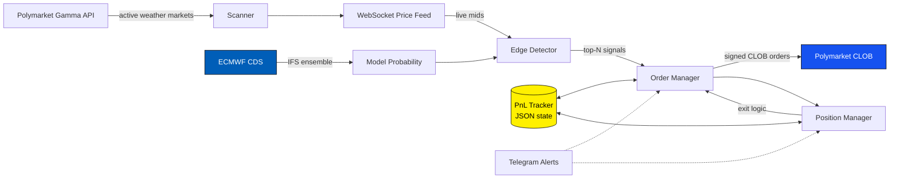

<div align="center">

# 🌦️ Polymarket Weather Bot

### Automated trading on Polymarket's weather markets — powered by raw ECMWF ensemble forecasts, not consumer weather APIs

*Find the edge most bots miss: scan → signal → execute → monitor, in a single autonomous loop.*

[](https://www.python.org/)
[](https://polymarket.com/)
[](https://www.ecmwf.int/)
[](https://www.docker.com/)
[]()
[]()
[](LICENSE)
[](http://makeapullrequest.com)
[]()

[**Quick Start**](#-quick-start) · [**Edge**](#-the-edge-why-this-bot-is-different) · [**Architecture**](#%EF%B8%8F-architecture) · [**Safety**](#-safety--risk-management) · [**Disclaimer**](#%EF%B8%8F-disclaimer)

</div>

---

## 🎯 Why this exists

Polymarket runs a steady stream of binary weather markets — "Will the high in NYC exceed 72°F on Tuesday?", "Highest temp in London between 18–19°C?" — that resolve against official meteorological stations. **These markets are systematically mispriced**: most participants quote off gut feel or free consumer forecasts, while professional weather data has been priced-in for decades on commodity desks.

Several public Polymarket accounts have turned $1k into the **mid-five figures** trading nothing but weather. The strategy isn't a secret. The *edge*, on the other hand, is.

This bot is built around that edge: it pulls raw **ECMWF IFS ensemble forecasts** from the [Copernicus Climate Data Store](https://cds.climate.copernicus.eu/), maps them to the exact temperature buckets Polymarket lists, computes probability vs. market price, and routes the top edges to signed CLOB orders — with crash-resistant state, real-time WebSocket pricing, and Telegram alerts.

> Paper-trades by default. You flip one flag to go live.

---

## ✨ Features

- 🛰️ **ECMWF IFS ensemble forecasts** via Copernicus CDS (51-member ensemble, not consumer APIs)
- 🌐 **Multi-source weather** — falls back to NWS / Open-Meteo where ECMWF lag matters less
- 📡 **Real-time WebSocket price feed** — Polymarket CLOB tokens streamed continuously, not polled
- 🎯 **Edge detector with Kelly-aware sizing** — top-N signals per cycle, configurable threshold
- 💼 **Built-in position management** — entries, exits, stop conditions, no manual babysitting
- 💾 **Crash-resistant JSON persistence** — survives container restarts without losing positions
- 📊 **Live PnL tracker** — open positions + cumulative PnL printed every 10 cycles
- 🚨 **Telegram alerts** on start / stop / error / restart (optional)
- 🧪 **DRY_RUN by default** — you have to opt-in to risk real capital
- 🐳 **Single-Dockerfile deploy** — Railway, Fly, Render, your own box, anywhere
- 💸 **~$3 / month** to run end-to-end

---

### 📡 Observation source: METAR.ws push (optional)

The real-time scalping bots (`bots/bot1_realtime`, `bots/bot2_realtime`) historically
polled `aviationweather.gov` on a systemd timer. With `METAR_SOURCE=metar_ws` they read a
snapshot maintained by `bots/metar_ws/metar_ws_daemon.py`, which holds **one persistent
WebSocket** to `wss://stream.metar.ws/v1/ws` and receives every METAR/SPECI the moment it
is published — no polling, no parsing, same source the markets resolve on. The daemon can
also fire `update_bot_rt.sh` on each live report (`METAR_WS_TRIGGER_CMD`), turning the
timer-driven cycle into an event-driven one. Setup: `deploy/systemd/README.md`
(section *METAR.ws push*). Default stays `METAR_SOURCE=awc`.

The daemon also keeps each station's **daily max/min over its local day** from every METAR
and SPECI (`core/station_day_state.py`), persisted in the snapshot. With `METAR_SOURCE=metar_ws`
the `temp_max` / `temp_min` signals of both RT bots are decided on that running extreme instead
of the instantaneous reading (`core/rt_daily_extrema.py`): a max that crossed the threshold is
final, a "stays below" market only wins at end of day, and it dies the moment the max crosses.

### 🖥️ Ops dashboard (read-only)

`python -m ui.server` serves a single-page dashboard on `http://127.0.0.1:8765/` built only
from files the daemon and the RT cycle already write (standard library, no extra
dependencies): stream health with per-station freshness against the station's scheduled
report minute, the daily max/min board with SPECI provenance and a sample sparkline, and
the market table joining `icao_mapping.json`, the RT signals, the daily extreme and the
Polymarket YES price (Gamma API) into gap, state and edge. Live refresh through
Server-Sent Events when the snapshot or the signals change. `UI_TOKEN` is required to bind
anything but loopback. Nothing in the UI can place or cancel an order.

## 🧠 The edge: why this bot is different

Most open-source Polymarket weather bots stop at the National Weather Service or Open-Meteo. Those sources are fine for casual use, but two structural limits make them weak as a trading edge:

1. **Single deterministic forecast** — no ensemble spread, so you can't estimate probability properly. You can say "the forecast is 71°F"; you can't say "there's a 78% chance the high exceeds 70°F."
2. **Same data everyone else has** — if your input is free and public, the market has already priced it in by the time you read it.

This bot uses the **ECMWF Integrated Forecasting System (IFS) ensemble** — 51 perturbed runs of the world's most accurate global model. The probability for any temperature threshold is just *the fraction of members above that threshold*. Combined with calibration against historical resolution data, you get a tight, well-grounded probability per market bucket.

```python
# Conceptual: how the probability comes out of an ensemble
prob_above_threshold = (ensemble_members > threshold).sum() / len(ensemble_members)
edge = prob_above_threshold - market_price
if abs(edge) > MIN_EDGE:
    place_order(...)
```

Accessing ECMWF data does require a (free) Copernicus account — covered in [setup](#%EF%B8%8F-ecmwf--copernicus-setup) below.

---

## 🏗️ Architecture



A single Python process running a deterministic cycle loop:

```
┌─────────────────────────────────────────────────────────┐
│  every WEATHER_REFRESH_SEC seconds:                     │
│  1. check open positions, apply exit logic              │
│  2. scan active weather markets (Polymarket Gamma)      │
│  3. subscribe WS to new token IDs                       │
│  4. compute model probability per market (ECMWF + bias) │
│  5. detect edges, rank by Kelly-adjusted EV             │
│  6. place top 3 orders (signed CLOB)                    │
│  7. flush PnL state to JSON                             │
│  8. every 10 cycles: print full PnL summary             │
└─────────────────────────────────────────────────────────┘
```

---

## 🚀 Quick Start

### 1. Clone & install

```bash
git clone https://github.com/yannbellec/polymarket-weather-bot.git
cd polymarket-weather-bot
pip install -r requirements.txt
cp .env.example .env
```

### 2. Configure (see [Configuration](#%EF%B8%8F-configuration))

Edit `.env` — at minimum you'll need:

- A Copernicus CDS API key (free, [register here](https://cds.climate.copernicus.eu/))
- A Polymarket proxy wallet + private key *(only required for LIVE mode)*

### 3. Run in paper mode

```bash
python main.py
```

You should see:

```
====================================================
 Bot started — Mode: DRY-RUN (simulation)
====================================================
── Cycle #1 ──────────────────────────────────
[scanner] Found 14 active weather markets
[signals] NYC ≥72°F  | model 0.81 | market 0.62 | edge +0.19
[signals] LON ≥18°C  | model 0.34 | market 0.52 | edge −0.18
[execution] (DRY) BUY 50 @ 0.62  NYC ≥72°F
...
```

### 4. Go live — *only* once paper performance is verified

In `.env`, set `DRY_RUN=false`. Restart. Real orders will flow.

### Docker

```bash
docker build -t pm-weather-bot .
docker run --env-file .env pm-weather-bot
```

---

## ⚙️ Configuration

All runtime configuration is read from `.env`. The most important variables:

| Variable | Required | Default | Description |
|---|---|---|---|
| `DRY_RUN` | ⬜ | `true` | If `true`, no real orders are placed. **Stay here until you trust the signals.** |
| `WEATHER_REFRESH_SEC` | ⬜ | `300` | Seconds between full cycles |
| `CDSAPI_KEY` | ✅ | — | Copernicus Climate Data Store API key |
| `CDSAPI_URL` | ⬜ | `https://cds.climate.copernicus.eu/api` | CDS endpoint |
| `POLYMARKET_PRIVATE_KEY` | live only | — | EVM private key for the signer wallet |
| `POLYMARKET_PROXY_WALLET` | live only | — | Your Polymarket proxy wallet (40-hex) |
| `MIN_EDGE` | ⬜ | `0.05` | Minimum edge (model prob − market price) to trade |
| `MAX_POSITION_USD` | ⬜ | `50` | Hard cap per individual position |
| `KELLY_FRACTION` | ⬜ | `0.25` | Quarter-Kelly sizing for safety |
| `TELEGRAM_BOT_TOKEN` | ⬜ | — | Bot token for alerts |
| `TELEGRAM_CHAT_ID` | ⬜ | — | Chat ID for alerts |

---

## 🛰️ ECMWF / Copernicus setup

The Copernicus Climate Data Store is **free** but requires a one-time registration.

1. Go to [cds.climate.copernicus.eu](https://cds.climate.copernicus.eu/) and create an account.
2. Visit your profile → **API key**. Copy the UID and key.
3. Paste them into `.env` as `CDSAPI_KEY`.
4. Accept the Terms of Use for the **"ENS — IFS ensemble forecast"** dataset (one-click, required by CDS).

The first ECMWF download may take 30–120 seconds depending on queue position; subsequent requests for cached time windows are near-instant.

---

## 🦊 Polymarket wallet setup *(LIVE mode only)*

> **Skip this if you only want to paper-trade.** The bot runs fine in `DRY_RUN` with no wallet at all.

1. On Polymarket, go to **Settings → Show your private key + proxy wallet**.
2. Paste both into `.env`.
3. Fund the proxy wallet with USDC.e on Polygon.
4. Confirm `DRY_RUN=false` and restart.

⚠️ **Treat your private key like cash.** Never commit `.env`. Never paste it in chat. The bot reads it locally only and never transmits it.

---

## 📁 Repo structure

```
polymarket-weather-bot/
├── main.py                # entry point — the cycle loop
├── status.py              # one-shot status / PnL inspector
├── config/                # settings, market filters, city → station mapping
├── core/                  # shared types, market dataclasses
├── scanners/
│   ├── market_scanner.py  # fetches active weather markets from Gamma API
│   └── ws_price_feed.py   # CLOB WebSocket; live mid prices per token
├── signals/
│   └── edge_detector.py   # ECMWF model prob vs market → ranked trade list
├── execution/
│   ├── order_manager.py   # signs + posts CLOB orders
│   └── position_manager.py# exit logic, stop conditions
├── monitoring/
│   ├── logger.py          # structured logs (rich)
│   ├── pnl_tracker.py     # JSON-persisted PnL + bankroll
│   └── telegram_alert.py  # optional Telegram hooks
├── notebooks/             # research, backtest scratchpads
├── tests/
├── Dockerfile
├── .env.example
└── requirements.txt
```

---

## 🔬 Strategy notes

A few things that disproportionately matter, and that this bot tries to get right:

- **Station resolution.** Polymarket markets resolve on a *specific* station (NYC = KLGA, not Central Park; Dallas = KDAL, not KDFW). City-centroid forecasts will systematically miss. The `config/` directory maps each market city to its true resolution station.
- **Forecast horizon dictates uncertainty.** A 6-hour-out forecast has ~0.5°C ensemble spread; a 5-day-out forecast can have 3°C+. Position sizing scales inversely.
- **Bucket edges are where the alpha lives.** A market priced at 0.50 with model probability 0.50 has no edge. A *neighboring* bucket priced at 0.10 with model probability 0.25 has +0.15 edge — boring buckets, big edges.
- **Liquidity is thin on tail buckets.** The bot caps order size per market and prefers limit orders inside the quoted book.

---

## 🛡️ Safety & risk management

This is real money in production mode. The bot ships with several guardrails:

- **DRY_RUN is the default.** You must explicitly flip it.
- **Hard per-position cap** (`MAX_POSITION_USD`) on top of Kelly sizing.
- **Quarter-Kelly sizing** by default. Full Kelly is mathematically optimal but psychologically punishing.
- **Crash-resistant state.** Every position is flushed to JSON immediately. If the container dies mid-trade, restart picks up where it left off.
- **Telegram alert on uncaught exception.** You'll know within seconds if something breaks.
- **Minimum hours-to-resolution guard** prevents entering markets that resolve in minutes (no time to manage exposure).

None of these makes you immune to losses. **You can lose all of your bankroll.** Read the [disclaimer](#%EF%B8%8F-disclaimer).

---

## 🗺️ Roadmap

- [ ] Backtesting harness over the last 90 days of resolved markets
- [ ] ECMWF + GFS ensemble blending with learned weights per city
- [ ] Calibration dashboard (Streamlit) — model vs realized per bucket
- [ ] International cities beyond US / EU
- [ ] Auto-tune `MIN_EDGE` per city from rolling Brier score
- [ ] Optional copy-trade mirror of top public Polymarket weather wallets

PRs warmly welcome.

---

## 🤝 Contributing

Genuine contributions are appreciated. Particularly:

- Better station mappings for non-US cities
- Calibration improvements (ensemble bias correction per station)
- More robust exit logic on thin order books
- Test coverage in `tests/`

Run `pytest` before opening a PR. Keep `DRY_RUN=true` in any example commands.

---

## ⚠️ Disclaimer

**This software is provided for research and educational purposes.** It is not financial advice. Prediction markets and on-chain trading carry substantial risk, including total loss of capital. Polymarket has geographic restrictions — verify it is legal to use in your jurisdiction before enabling LIVE mode. Weather forecasts are probabilistic, and even the best models are sometimes badly wrong. Past performance of any strategy is not indicative of future results.

By using this software in LIVE mode you accept full responsibility for any outcomes, and you agree that the authors carry no liability for losses, missed trades, software bugs, exchange downtime, or any other adverse event.

**Stay in DRY_RUN until you have read the code, understood the strategy, and run it long enough to trust the signals on your own data.**

---

## 📜 License

[MIT](LICENSE) © [yannbellec](https://github.com/yannbellec)

---

<div align="center">

### ⭐ If this saves you a week of plumbing, please star the repo — it genuinely helps.

[](https://star-history.com/#yannbellec/polymarket-weather-bot&Date)

</div>
